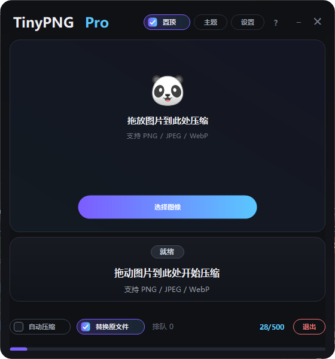

# TinyPNG Pro .NET


一个面向 Windows 10 / 11 的 TinyPNG 桌面客户端：拖放图片即压缩，单个 exe 便携运行，配置与日志都放在程序同目录。

> 本项目是 [TinyPNG](https://tinypng.com/) 的**第三方非官方客户端**，与 TinyPNG / Tinify 官方无隶属关系。使用前需要自备 TinyPNG API Key。



## 功能特性

- **拖放 / 多选压缩**：支持 PNG、JPEG、WebP；也可只压缩 PNG。
- **文件夹监控**：监控一个或多个目录，对监控启动后新增或重新保存的图片自动压缩（非递归）。
- **多 Key 管理**：最多保存 3 个 TinyPNG API Key，可切换当前 Key 并单独验证。
- **两种输出方式**：覆盖原文件，或输出到指定目录（文件名追加 `_compressed`）。
- **额度进度**：读取 TinyPNG 响应头 `Compression-Count`，显示当月已用次数与进度条。
- **后台队列**：单 worker 串行压缩，手动任务优先；批量结束后汇总成功率、节省比例与耗时。
- **桌面集成**：托盘常驻、关闭到托盘、窗口置顶、开机自启、单实例运行。
- **双主题**：夜间 / 明亮，切换即时生效并持久化。
- **日志查看**：按日期写入 `logs/`，可在应用内查看和清空。
- **无边框自绘界面**：四边四角可缩放，左键 / 中键可在窗口任意位置拖动，任意位置右键菜单。

## 快速开始

1. 从 Releases 下载 `TinyPNG Pro.exe`（或按下方步骤自行构建）。
2. 把 exe 放到一个**可写目录**（例如用户目录或桌面）。程序不需要安装；除可选的 HKCU 开机自启项外，不写入系统目录。
3. 打开 [TinyPNG Developer API](https://tinypng.com/developers) 申请一个 API Key。
4. 启动程序，进入「设置 → API 设置」，填入 Key，点击「验证」后保存。
5. 把图片拖进窗口，或点击「选择图像」开始压缩。

> 不建议把程序放在 `C:\Program Files` 等需要管理员权限的目录，否则 `config.ini` 可能无法写入。

## 构建方式

构建只依赖 Windows 自带的 .NET Framework 4.8 编译器，**不需要安装 .NET SDK、Visual Studio 或任何 NuGet 包**。

```bat
build-nosdk.cmd
```

脚本会调用 `%WINDIR%\Microsoft.NET\Framework64\v4.0.30319\csc.exe`，把 `src/` 下的 C# 源码编译为：

```text
dist\TinyPNG Pro.exe
```

产物为单个 exe，无 DLL、无 PDB。当前版本约 123 KB。

构建环境要求：

- Windows 10 / 11
- .NET Framework 4.8（Windows 10 22H2 及 Windows 11 默认内置）
- 无需联网，无需包管理器

## 配置文件与数据位置

所有运行期文件都在 **exe 所在目录**，删除后即可恢复默认设置：

| 文件 / 目录 | 用途 |
|---|---|
| `config.ini` | API Key、压缩设置、监控目录、超时、主题、自启等 |
| `processed_state.json` | 自动压缩去重账本（路径 → 修改时间 / 大小） |
| `logs\YYYY-MM-DD.log` | 按日期切分的运行日志 |

`config.ini` 的主要分区：

```ini
[API]
api_key_1 =
api_key_2 =
api_key_3 =
active_key = 1
compression_count = 0

[Compression]
replace_original = True
only_png = True
output_path =

[AutoCompression]
enabled = False
watch_folders =

[Settings]
timeout = 30
close_to_tray = True
always_on_top = False
notification_duration = 5
logging_enabled = True
theme = dark

[Startup]
auto_start = False
```

> API Key 按原版设计以明文写入本地 `config.ini`，不会上传到除 TinyPNG 之外的任何服务。请不要把 `config.ini`、`processed_state.json`、`logs/` 提交到 Git（仓库的 `.gitignore` 已默认排除）。

## 技术栈

- **语言 / 运行时**：C# 5.0，.NET Framework 4.8
- **界面**：WinForms + GDI+ 自绘控件（无第三方 UI 库）
- **网络**：`HttpClient` 直连 `https://api.tinify.com`，无第三方 SDK
- **构建**：系统内置 `csc.exe`，零 NuGet、零安装
- **产物**：单个 `winexe`，便携运行

## 项目结构

```text
.
├─ src/
│  ├─ TinyPNGPro.App/        # WinForms 界面、主题、托盘、拖放
│  └─ TinyPNGPro.Core/       # 配置、HTTP、队列、监控、账本、日志
├─ docs/screenshot.png       # README 截图
├─ app.manifest              # DPI 感知与长路径声明
├─ build-nosdk.cmd           # 内置 csc 构建脚本
├─ .gitignore
└─ LICENSE
```

## 常见问题

**这是 TinyPNG 官方软件吗？**
不是。这是第三方开源客户端，仅调用 TinyPNG 公开 API。TinyPNG、Tinify 及相关商标归其各自所有者。

**压缩会把图片上传到哪里？**
只会 POST 到 `https://api.tinify.com/shrink`，随后从响应返回的 `Location` 下载结果；不会上传无关文件，也不含统计或埋点。

**免费额度是多少？**
TinyPNG 官方目前为每个账号每月 500 次免费压缩（单文件大小上限以官方套餐为准）。本项目只负责显示 `Compression-Count`，额度规则以 TinyPNG 官方为准。

**为什么图片被直接覆盖了？**
默认 `replace_original = True`。不想覆盖原图时，在「设置 → 高级设置」关闭「替换原文件」，并配置输出目录；未配置有效目录时会输出到原目录并追加 `_compressed`。

**监控文件夹为什么没反应？**
监控只处理**监控启动之后**新增或重新保存的文件，且不递归子目录；启动前已存在的文件会被跳过。此外，账本会阻止同一文件被重复压缩。

**为什么 Windows 提示未知发布者？**
exe 未做代码签名，SmartScreen 可能给出提示。可核对文件来源后选择「仍要运行」。

**支持哪些系统？**
仅 Windows 10 / 11（x64）。不支持 Windows 7 / 8、macOS 与 Linux。

**真实 API Key 的完整链路验证了吗？**
上传 / 下载、重试、错误映射与额度解析均已实现；但不同账号、网络环境、限额状态下的边界行为尚未系统化验证，遇到问题请附日志提交 Issue。

## 许可与免责声明

- 本项目以 [MIT License](LICENSE) 开源，版权署名为 `TinyPNG Pro .NET contributors`。
- 本项目移植自 windmemo 的 TinyPNG Pro（MIT License），保留原始版权声明。
- 软件按「现状」提供，不附带任何明示或暗示担保。压缩结果、额度消耗与网络可用性由 TinyPNG 官方服务决定。
- 使用本项目即表示你同意自行承担 API Key 保管、图片上传与数据合规责任。
